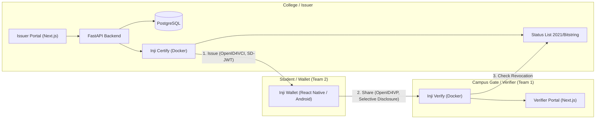

# Project Implementation Plan: Digital Identity Wallet (Campus ID on MOSIP Inji)

Based on the [Detailed Problem Statement](file:///Users/mahendrakumar/Documents/antigravity/charming-volta/.context/problem-statement.md) and [Team Split Specification](file:///Users/mahendrakumar/Documents/antigravity/charming-volta/.context/team-split.md), here is the step-by-step roadmap to build, test, and demonstrate the standards-based Digital Identity Wallet platform.

> [!TIP]
> Live task progress and execution checklists for both teams are maintained in the [`.work/` directory](file:///Users/mahendrakumar/Documents/antigravity/charming-volta/.work/README.md).
> AI agents must log all completed actions in [AI_TASK_LOG.md](file:///Users/mahendrakumar/Documents/antigravity/charming-volta/AI_TASK_LOG.md).


---

## 1. High-Level Architecture & Lifecycle



---

## 2. Shared Credential Specification (Campus ID)

- **Format:** SD-JWT (Selective Disclosure JSON Web Token) to allow field-level omission.
- **Protocols:**
  - **Issuance:** OpenID4VCI
  - **Verification:** OpenID4VP
- **Schema Attributes:**
  - `name` (String, e.g. "Jane Doe")
  - `roll_number` (String, e.g. "2024CS012")
  - `branch` (String, e.g. "Computer Science & Engineering")
  - `enrollment_status` (String, enum: `ACTIVE`, `GRADUATED`, `SUSPENDED`, `REVOKED`)
  - `valid_until` (ISO Date string, e.g. `2028-06-30`)
  - `photo` (Optional, base64 data URI or reference)
- **Revocation Mechanism:** W3C Status List (Token Status List / Bitstring Status List) served by the Issuer.

---

## 3. Phased Roadmap

### Phase 1: Environment Setup & Exploration (Day 1 - 2)
- [ ] **Prerequisites Verification:**
  - Docker & Docker Compose (for running Inji Certify and Inji Verify).
  - Node.js (v18+) & Python (3.10+) for portals & API.
  - Android Studio & React Native environment (Java 17, Android SDK, ADB).
- [ ] **Clone / submodule Inji repositories:**
  - Inji Certify / Mock Identity Provider
  - Inji Verify
  - Inji Wallet (React Native app)
- [ ] **Establish Repository Structure** inside `digital-identity-wallet`:
  ```text
  digital-identity-wallet/
  ├── .context/               # Specifications, schemas, meeting notes, guides
  ├── backend/                # FastAPI + PostgreSQL (Issuer admin & verifier API)
  ├── portals/
  │   ├── admin/              # Next.js Issuer Admin Portal
  │   └── verifier/           # Next.js Verifier Portal
  ├── services/
  │   ├── docker-compose.yml  # Inji Certify, Inji Verify, Postgres, Mock Auth
  │   └── certify-config/     # Schema definitions, key pairs, status list config
  └── wallet/                 # Forked/customized Inji Wallet (React Native)
  ```

---

### Phase 2: Team 1 Execution — Issuer, Verifier & Portals (Days 3 - 6)

#### 2.1 Inji Certify & Schema Configuration (Member 1 - Kislay)
- [ ] Define the `CampusID` schema matching SD-JWT format in Inji Certify.
- [ ] Set up mock authentication (student login simulation).
- [ ] Configure signing keys and OpenID4VCI metadata endpoint (`/.well-known/openid-credential-issuer`).
- [ ] Implement credential status list publication for revocation.

#### 2.2 Inji Verify & Portals (Member 2)
- [ ] Spin up Inji Verify with Docker Compose.
- [ ] Build **FastAPI backend** (`/api/v1`):
  - Student database (mock enrollment records).
  - Revocation triggers (`POST /revoke/{roll_number}`).
  - Audit logging of issued credentials.
- [ ] Build **Next.js Admin & Verifier Portal**:
  - **Admin View:** List students, one-click issue with QR code / deep link, revoke action.
  - **Verifier View:** Generate OpenID4VP QR code, receive presentation, display verified fields vs. hidden fields, show validity/revocation status.

#### 2.3 Standalone Milestone 1 Demo
- Admin issues Campus ID -> Stock Inji Wallet or test verifier client receives it -> Verifier scans and shows "VALID" -> Admin revokes -> Verifier scans and shows "REVOKED".

---

### Phase 3: Team 2 Execution — Inji Wallet Customization (Days 3 - 6)

#### 3.1 Wallet Build & Card Rendering (Member 3)
- [ ] Set up local build for Inji Wallet on Android (`android/` build via Gradle).
- [ ] Implement Campus ID custom card component:
  - Header: College branding & logo.
  - Body: Student Name, Roll No, Branch, Valid-Until date, Status badge.
  - Handling of optional photo.
- [ ] Test receiving Campus ID via OpenID4VCI from an Inji demo issuer or mock server.

#### 3.2 Selective Disclosure & History (Member 4)
- [ ] **Selective Disclosure Consent Screen:**
  - Intercept OpenID4VP presentation requests.
  - Render list of requested attributes with switches/checkboxes.
  - Only sign/disclose approved SD-JWT claims.
- [ ] **Local Sharing History Screen:**
  - Store disclosure logs in local SQLite / encrypted storage (`Shared with: Library, Date: 16 Oct, Disclosed: [Name, Roll Number]`).
  - View list of previous presentations.

#### 3.3 Standalone Milestone 2 Demo
- Wallet receives credential from demo issuer -> displays Campus ID -> verifier asks for proof -> user untoggles "roll number" or "photo" -> verifier only sees toggled fields.

---

### Phase 4: Joint Integration & End-to-End Testing (Day 7+)
1. **Network Alignment:** Configure local LAN / ngrok / reverse proxy so Android device or emulator can communicate with local Inji Certify & Verify services.
2. **End-to-End Walkthrough:**
   1. College Admin issues Campus ID to Student.
   2. Student scans QR code in custom Inji Wallet to claim credential.
   3. Student presents ID to Campus Verifier with selective disclosure (e.g., reveal only `enrollment_status` and `valid_until` for campus entry).
   4. Verifier approves.
   5. Admin revokes credential in Admin Portal.
   6. Student presents again -> Verifier rejects with "REVOKED".
3. **Backup Plan:** Standalone demos recorded as video fallback in case of local network/Docker issues during review.

---

## 4. Next Immediate Steps

1. **Clarify your role:** Are you working primarily on **Team 1** (Backend, Portals, Certify/Verify) or **Team 2** (Android / React Native Wallet), or coordinating both?
2. **Infrastructure Bootstrap:** Initialize the folder structure and local services (Docker Compose for Inji stack + PostgreSQL).
