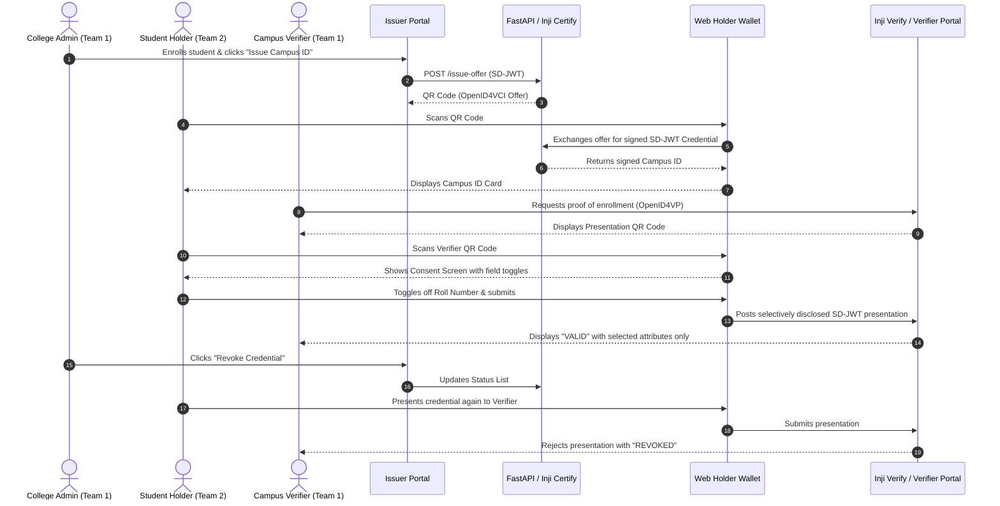

# Joint Integration Track & Verification

**Assigned Members:** All (Members 1, 2, 3, 4)  
**Current Milestone:** Milestone 3.1 — Contract & Schema Harmonization  
**Current Status:** 🟡 Not Started (`0%`)

---

## 1. Integration Scope

This track covers the convergence of Team 1's Issuer/Verifier backend and Team 2's Holder Wallet into a unified, live end-to-end demonstration.

---

## 2. Integration Milestones & Checklists

### 3.1 Contract & Schema Harmonization
- [ ] Confirm exact claim keys across Issuer, Wallet, and Verifier (`name`, `roll_number`, `branch`, `enrollment_status`, `valid_until`, `photo`).
- [ ] Align SD-JWT disclosure framing: ensure salt generation in Certify matches disclosure extraction in Wallet.
- [ ] Verify OpenID4VCI and OpenID4VP request/response payloads meet spec.

### 3.2 Network Configuration & Port Mapping
- [ ] Localhost / Docker port assignments defined without collision:
  - `3000`: Issuer Admin Portal (Next.js)
  - `3001`: Verifier Portal (Next.js)
  - `3002`: Web Holder Wallet (Next.js / React)
  - `8000`: FastAPI Backend Service
  - `8080`: Inji Certify (Docker)
  - `8081`: Inji Verify (Docker)
  - `5432`: PostgreSQL
- [ ] CORS policies properly configured between web portals and APIs.

### 3.3 End-to-End Workflow Verification
- [ ] Full positive issuance flow: Admin issue -> Wallet claim.
- [ ] Full positive presentation flow: Verifier scan -> Consent -> Presentation valid.
- [ ] Selective disclosure verification: Ensure undisclosed claims cannot be reconstructed by Verifier.
- [ ] Revocation verification: Admin revoke -> Verifier scan shows "REVOKED".

### 3.4 Tampering & Security Negative Tests
- [ ] Tampered claim payload test: Verifier detects signature mismatch.
- [ ] Expired credential test: Verifier flags `valid_until` in the past.
- [ ] Untrusted issuer test: Verifier rejects credential signed by unknown key.
- [ ] Holder rejection test: Wallet cancels presentation safely without leaking data.
